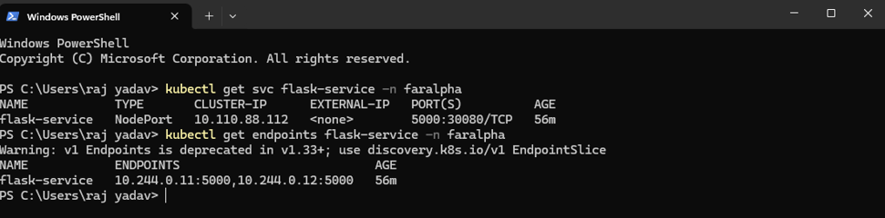
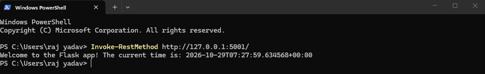
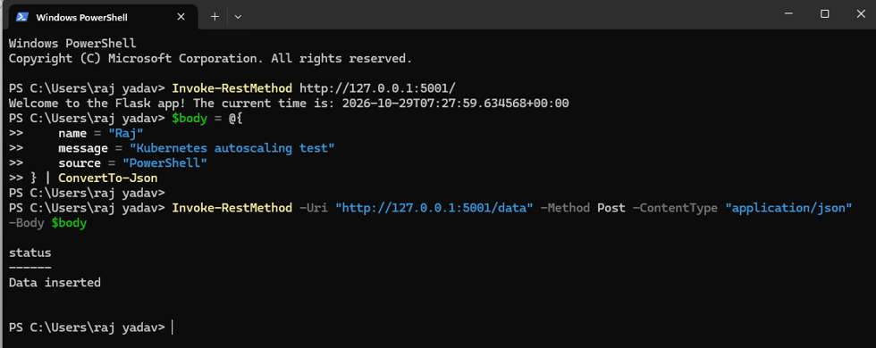
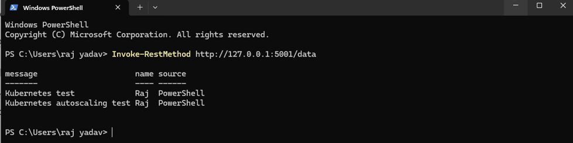
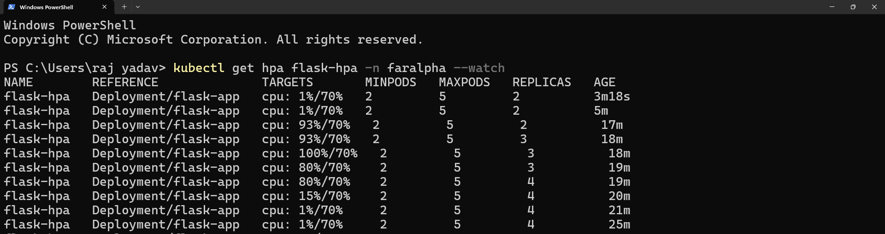
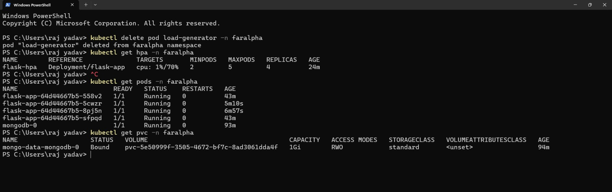

# FarAlpha SDE Intern Assignment — Flask, MongoDB, and Kubernetes

A Python Flask API backed by MongoDB authentication, deployed on a local Minikube Kubernetes cluster. The project includes a two-replica Flask Deployment, internal MongoDB StatefulSet, persistent storage, resource requests/limits, and a CPU-based Horizontal Pod Autoscaler (HPA).

> **Credentials:** YAML files ending in `example` contain demo-only values. Do not put real credentials in GitHub. For a fresh deployment, keep the MongoDB root credentials in `mongodb-secret.example.yaml` consistent with the username/password you use when logging in. Keep the app user's password identical in the MongoDB user creation command and `flask-config.example.yaml`. The sample ConfigMap includes a demo-only connection URI to make this local assignment reproducible; for production, store the full MongoDB URI (including the application password) in a Kubernetes Secret instead of a ConfigMap. MongoDB initialization credentials are applied only when the data directory is first initialized; changing a Kubernetes Secret later does not automatically change an existing MongoDB user's password.

## Project structure

All Kubernetes YAML files are in the repository root, matching the commands below.

```text
.
├── app.py
├── requirements.txt
├── Dockerfile
├── namespace.yaml
├── mongodb-secret.example.yaml
├── mongodb-service.yaml
├── mongodb-statefulset.yaml
├── flask-config.example.yaml
├── flask-deployment.yaml
├── flask-service.yaml
├── flask-hpa.yaml
├── 01-service-endpoints.png
├── 02-welcome-endpoint.png
├── 03-post-data.png
├── 04-hpa-autoscaling.png
├── 05-final-pods-pvc.png
├── 06-get-data.png
└── README.md
```

## Architecture and requirements

- **Flask Deployment:** 2 initial replicas; HPA permits 2–5 replicas.
- **Flask Service:** NodePort `30080` to container/service port `5000`. On Windows with Minikube's Docker driver, `kubectl port-forward` is the most predictable local testing method.
- **MongoDB:** authenticated StatefulSet with a headless, cluster-internal Service; it is not published via NodePort or LoadBalancer.
- **Persistent data:** 1 GiB PVC mounted at MongoDB's `/data/db`.
- **HPA:** `autoscaling/v2`, average CPU utilization target 70%, minimum 2 and maximum 5 replicas.
- **Resources:** both Flask and MongoDB request `200m` CPU / `250Mi` memory and limit `500m` CPU / `500Mi` memory.
- **Application routes:** `GET /` returns a welcome message and timestamp; `GET /data` reads documents; `POST /data` inserts a JSON object; `/health` is used for Flask readiness checks.

## Prerequisites

Install Docker Desktop, `kubectl`, and Minikube. Start Docker Desktop and make sure its engine is running. On Windows, complete WSL 2 setup if Docker Desktop requires it.

```powershell
docker --version
kubectl version --client
minikube version
```

## 1. Start Minikube and Metrics Server

Run in PowerShell:

```powershell
minikube start --driver=docker
minikube addons enable metrics-server
kubectl get nodes
kubectl top nodes
```

Wait until `kubectl top nodes` returns CPU/memory metrics before checking HPA behavior.

## 2. Create the namespace, Secret, and MongoDB

Before applying the example Secret, open `mongodb-secret.example.yaml`. Replace demo values locally if desired. Do not commit real credentials. For a fresh database, use the same root username/password when logging into MongoDB below.

```powershell
kubectl apply -f namespace.yaml
kubectl apply -f mongodb-secret.example.yaml
kubectl apply -f mongodb-service.yaml
kubectl apply -f mongodb-statefulset.yaml
kubectl rollout status statefulset/mongodb -n faralpha --timeout=180s
kubectl get pods,pvc -n faralpha
kubectl get pv
```

The StatefulSet's `volumeClaimTemplates` creates a 1 GiB PVC. On Minikube, the default StorageClass dynamically provisions the backing PersistentVolume (PV); verify both the claim is `Bound` and a PV exists with `kubectl get pvc -n faralpha` and `kubectl get pv`.

Create the application user after the MongoDB pod is ready. The configured connection string authenticates the application user against MongoDB's `admin` database and accesses the `flask_db` database.

```powershell
kubectl exec -it mongodb-0 -n faralpha -- mongosh -u adminuser -p --authenticationDatabase admin
```

At the password prompt, enter the `MONGO_ROOT_PASSWORD` from the Secret. At the `test>` prompt, run:

```javascript
use admin
db.createUser({
  user: "flaskuser",
  pwd: "change-this-app-password",
  roles: [{ role: "readWrite", db: "flask_db" }]
})
```

Use the same application password in `flask-config.example.yaml`. If MongoDB reports that `flaskuser` already exists, do not create it again; instead grant the required role:

```javascript
db.grantRolesToUser("flaskuser", [{ role: "readWrite", db: "flask_db" }])
```

Then leave the shell with `exit`. Never delete the StatefulSet's PVC to solve a password mismatch; changing a Secret does not update users in an already-initialized database.

## 3. Build the Flask container image

Run these commands from the repository root with Docker Desktop running. This is the tested local Minikube workflow:

```powershell
docker build -t faralpha-flask:1.0 .
minikube image load faralpha-flask:1.0
```

The Deployment uses `image: faralpha-flask:1.0` with `imagePullPolicy: IfNotPresent`, so the image must be available inside Minikube for this workflow.

### Optional: build and push to Docker Hub

The assignment also asks for instructions to publish the image to a container registry. Replace `YOUR_DOCKERHUB_USERNAME` with your actual Docker Hub username. This path is optional for the local Minikube test above.

```powershell
docker login
docker tag faralpha-flask:1.0 YOUR_DOCKERHUB_USERNAME/faralpha-flask:1.0
docker push YOUR_DOCKERHUB_USERNAME/faralpha-flask:1.0
```

After pushing, change the `image` field in `flask-deployment.yaml` to `YOUR_DOCKERHUB_USERNAME/faralpha-flask:1.0`, then apply the updated Deployment:

```powershell
kubectl apply -f flask-deployment.yaml
kubectl rollout status deployment/flask-app -n faralpha --timeout=180s
```

For a public Docker Hub image, Minikube can pull the image without a private-registry Secret. Do not commit registry credentials, access tokens, or real database passwords to GitHub.

## 4. Configure and deploy Flask

Review `flask-config.example.yaml`: it should use `flaskuser`, the application password, database `flask_db`, and `authSource=admin`. Apply the ConfigMap and application resources:

```powershell
kubectl apply -f flask-config.example.yaml
kubectl apply -f flask-deployment.yaml
kubectl apply -f flask-service.yaml
kubectl rollout status deployment/flask-app -n faralpha --timeout=180s
kubectl get pods,svc,pvc -n faralpha
```

## 5. Test the HTTP endpoints and MongoDB operations

In **PowerShell terminal 1**, start port-forwarding. Port `5001` on the host is used to avoid a possible local conflict on port `5000`:

```powershell
kubectl port-forward service/flask-service 5001:5000 -n faralpha
```

Keep that terminal open. In **PowerShell terminal 2**:

```powershell
Invoke-RestMethod http://127.0.0.1:5001/

$body = @{
    name = "Raj"
    message = "Kubernetes test"
    source = "PowerShell"
} | ConvertTo-Json

Invoke-RestMethod -Uri "http://127.0.0.1:5001/data" -Method Post -ContentType "application/json" -Body $body
Invoke-RestMethod http://127.0.0.1:5001/data
```

Expected observations: `/` returns the welcome text with a timestamp; successful POST returns `status: Data inserted`; GET returns the stored documents. The successful POST response and a follow-up GET showing the inserted documents were both captured in the evidence screenshots.

## 6. Configure and test HPA autoscaling

Apply HPA and check metrics:

```powershell
kubectl apply -f flask-hpa.yaml
kubectl get hpa -n faralpha
kubectl top pods -n faralpha
kubectl describe hpa flask-hpa -n faralpha
```

Make a temporary BusyBox pod that can send traffic. If a previous pod with this name exists, remove it first:

```powershell
kubectl delete pod load-generator -n faralpha --ignore-not-found
kubectl run load-generator -n faralpha --image=busybox:1.36 --restart=Never --command -- sleep 3600
kubectl wait --for=condition=Ready pod/load-generator -n faralpha --timeout=120s
```

In a **separate terminal**, watch HPA metrics:

```powershell
kubectl get hpa flask-hpa -n faralpha --watch
```

In another terminal, start parallel request loops. The Kubernetes Service port is **5000** (not the NodePort `30080` and not port `3000`):

```powershell
kubectl exec -it load-generator -n faralpha -- sh -c "for i in 1 2 3 4 5 6 7 8; do (while true; do wget -q -O- http://flask-service:5000/ >/dev/null 2>&1; done) & done; wait"
```

Watch the HPA output and wait for CPU metrics and replica count changes. In another terminal, you can run:

```powershell
kubectl get pods -n faralpha
kubectl top pods -n faralpha
kubectl get deployment flask-app -n faralpha
```

To stop the active test, press `Ctrl+C` in the terminal running the load command, then remove the temporary pod:

```powershell
kubectl delete pod load-generator -n faralpha
```

### Actual observed autoscaling results

These values are based on the HPA watch output captured from the completed test in this environment; they are not estimated placeholders.

| Observation | Result |
|---|---|
| Initial replicas | 2 |
| CPU utilization target | 70% |
| Minimum / maximum replicas | 2 / 5 |
| CPU samples during load | 93%, 100%, 80% |
| Highest replica count observed | 4 |
| After load stopped | CPU fell to 15%, then 1%; replicas eventually returned to 2 |
| Temporary load-generator pod | Deleted after the test |
| POST `/data` | Confirmed: returned `Data inserted` |
| GET `/data` after POST | Confirmed: GET returned both inserted test documents |

The maximum configured limit is 5 replicas; this test reached 4, not 5. HPA scale-down is delayed by its stabilization behavior, so replicas may remain above 2 for a while after the load is stopped.

## Evidence screenshots

The following screenshots are from the actual test session:

### Flask Service and endpoints



### Welcome endpoint



### Successful POST data insert



### GET data verification



### HPA scale-up and scale-down observations



### Final pods and persistent volume claim



## Kubernetes DNS

Pods in namespace `faralpha` can reach Flask through `flask-service:5000`. MongoDB is internal-only and reachable at the StatefulSet DNS name `mongodb-0.mongodb.faralpha.svc.cluster.local:27017`. The headless Service named `mongodb` provides stable DNS for the StatefulSet pod. The MongoDB connection string includes `authSource=admin` because the application user is created in the `admin` authentication database, while its `readWrite` role is scoped to `flask_db`.

## Resource requests and limits

Requests help Kubernetes schedule pods and form the baseline for CPU utilization calculations in HPA. Limits cap consumption; CPU over the limit can be throttled, and excessive memory can result in an OOM kill. This assignment sets requests to `200m` CPU / `250Mi` memory and limits to `500m` CPU / `500Mi` memory for the Flask and MongoDB containers.

## Design choices

- Flask runs under Gunicorn instead of Flask's development server.
- The Deployment starts with two replicas; the HPA uses `autoscaling/v2`, 70% CPU target, minimum 2, and maximum 5.
- MongoDB runs in a StatefulSet with a 1 GiB PVC so its data is stored outside the writable container layer.
- MongoDB uses a headless Service and is not exposed outside the cluster.
- Resource requests are set on Flask so HPA CPU utilization has a meaningful denominator.
- A single MongoDB replica is appropriate for a local exercise, not production high availability. Production deployments would require stronger secret management, backups, TLS, network policies, and a replica-set architecture.

## Troubleshooting

- **`ImagePullBackOff`:** verify `docker build -t faralpha-flask:1.0 .` succeeded and `minikube image load faralpha-flask:1.0` completed.
- **HPA target `<unknown>`:** run `minikube addons enable metrics-server`, wait, and verify `kubectl top pods -n faralpha`.
- **`Connection refused` from the load generator:** use the in-cluster Service port `flask-service:5000`. `30080` is the NodePort exposed from the host.
- **MongoDB authentication/authorization errors:** verify the app password matches the password in `flask-config.example.yaml`, the user exists in MongoDB's `admin` database, and it has `readWrite` on `flask_db`. For an existing PVC, changing the Secret alone does not modify MongoDB's stored credentials.
- **PVC pending:** inspect `kubectl get pvc -n faralpha` and `kubectl get storageclass`.
- **Application failure:** inspect `kubectl logs deployment/flask-app -n faralpha` and `kubectl describe pod <pod-name> -n faralpha`.

## Cleanup

Only use this if you want to remove the assignment resources after evaluation. Deleting the namespace also deletes its PVC and stored MongoDB data.

```powershell
kubectl delete namespace faralpha
minikube stop
```
